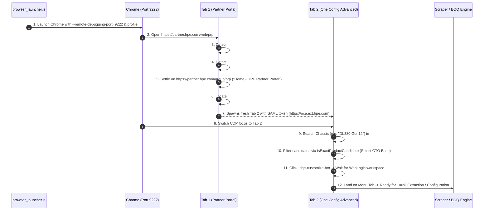

# HPE Partner Portal & OCA Auto-Navigator Skill (`oca-portal-navigator`)

This skill automates HPE Partner Portal (`https://partner.hpe.com`) authentication, Quick Links launch, chassis search and configuration-menu entry using CDP on port 9222. Browser connectivity, portal authentication and OCA configuration readiness are separate checks. Authentication can require current credentials or a vendor-controlled challenge.

Critically, this skill formalizes the **Stale-Session Self-Healing Recovery Protocol (INV-89)**, which recovers from WebLogic timeouts, silent freezes, and unhandled exceptions by returning to Tab 1 (Partner Portal) to refresh tokens rather than breaking state via in-place OCA page reloads.

---

## 1. Why CDP Port 9222 & Persistent Profile

| Metric | Playwright / Selenium | CDP Port 9222 with `.chrome_sso_profile` |
|---|---|---|
| **Dependency Weight** | > 300 MB browser binaries | **0 MB (Uses system Chrome WS)** |
| **SSO Credential Persistence** | Depends on context/profile | Reuses the browser currently bound to the port; a new launcher-owned browser uses `.chrome_sso_profile` |
| **Authentication** | Depends on session and identity provider | Submits configured or saved credentials; MFA/CAPTCHA is not bypassed |
| **WebLogic Popup & Window Handling** | Traps on `window.open` tabs | **Dynamic CDP page target discovery across all tabs** |
| **Recovery from Frozen State** | Requires restarting browser | **Recovers in seconds via Tab 1 Quick Links reload** |

### Vendor Credential Resolution Hierarchy
The HPE navigator reads its credential environment after loading the repository `.env`. The multi-vendor credential helper follows the same HPE environment convention:
1. **Environment Override**: `HPE_PORTAL_USER` and `HPE_PORTAL_PASS` in `.env`.
2. **Default Partner Identity**: Defaults to `hpeconfig@swiftline-uae.com` if `HPE_PORTAL_USER` is unspecified.
3. **Chrome Profile Session**: Without a configured password, saved credentials/cookies may be used if they exist in the connected profile. A responsive port does not guarantee HPE authentication. NotebookLM may already own port 9222 with its own profile; preserve that browser and its unrelated tabs. Never print credentials or copy credential databases between profiles.

### Verified session startup and recovery contract (2026-10-19)

Read [the current session startup and recovery runbook](../../../docs/audits/2026-10-19-oca-session-startup-remediation.md). Use the canonical command:

```powershell
npm.cmd run oca:session -- "DL380 Gen12"
npm.cmd run oca:session -- --recover "DL380 Gen12"
```

The first command reuses an exact active commercial configuration. The second deliberately replaces OCA via Partner Portal. Both write sanitized receipts under `outputs/history/oca_sessions/`. `READY_AT_MENU_TAB` / `NAVIGATED_TO_CONFIG_PAGE` proves navigation only; it does not prove scrape coverage, customer buildability, CLIC acceptance or cloud synchronization.

Do not classify a commercial configuration as OEM because it contains the **OEM Software** category. OEM eligibility and target SKU must be checked against the base-product identity. Verify the actual password field after CDP input and dispatch input/change events; background focus and delayed Onepass dialogs can otherwise leave an empty form. Do not treat `/group/prp` alone as proof of authentication while a password dialog remains visible.

Authentication failures must retain their stage: `HPE_AUTH_CREDENTIALS_REQUIRED`, `HPE_AUTH_REJECTED`, `HPE_AUTH_INTERACTION_REQUIRED`, or `HPE_AUTH_TIMEOUT`. They must not be swallowed and followed by a misleading launcher attempt. The connected profile may require a vendor-controlled challenge; report that exact blocker instead of claiming automatic MFA bypass.

---

## 2. The 12-Step Autonomous Navigation Lifecycle



### Atomic Stages Breakdown

1. **Browser Auto-Launch (`browser_launcher.js`)**:
   Checks if Chrome is listening on port 9222. If not, spawns `google-chrome` with `--remote-debugging-port=9222`, `--user-data-dir=.chrome_sso_profile`, and initial URL `https://partner.hpe.com/web/prp`.
2. **Landing Page Sign-In Detection**:
   Inspects DOM for `#oktaSignInBtn` or `button.btn-sign-in` ("Sign in") and triggers click.
3. **Automated Credential Modal Submission**:
   Detects the Onepass credential modal where email (`#oktaEmailInput`) and password (`#password-sign-in`) are auto-populated from Chrome's saved profile. Clicks the green submit button (`#onepass-submit-btn` / `button.submit-btn`) and dispatches simulated mouse clicks at center coordinates.
4. **Partner Portal Settlement**:
   Waits patiently for redirect to settle on `https://partner.hpe.com/group/prp` with page title "Home - HPE Partner Portal".
5. **Quick Links Discovery**:
   Locates the "One Config Advanced" launcher inside `.quickLinksContainer` at `#quick-links-807 a` (or element with `eServiceId=187402`).
6. **SAML SSO Tab Spawning**:
   Clicks the Quick Link, executing `updateToolActivity('187402')` and spawning `https://oca.ext.hpe.com/oca/OCAInternalLogin` in a new browser tab with fresh SAML tokens.
7. **CDP Target Switch**:
   Queries `http://localhost:9222/json` to acquire the WebSocket URL of the new OCA page target.
8. **Chassis Query Execution**:
   Switches to "Product Catalog" mode if required, enters the chassis search query (e.g., "DL380 Gen12") into `#searchProductInput`, and triggers `input` and `change` events.
9. **Candidate Triage & CTO Selection**:
   Runs `extractCandidates()` and filters using `isExactProductCandidate(query, candidate)`. Selects the standard Configure-To-Order (CTO) base chassis (e.g., `P73282-B21`) while strictly rejecting BTO, TAA (`#GTA`), and discontinued parts.
10. **Customization Trigger**:
    Selects standalone enclosure/rack if required and clicks the customize button (`.dqe-customize-btn`).
11. **WebLogic Configuration Load**:
    Waits for the legacy WebLogic Java workspace to render and passes through any intermediate customization gateway pages.
12. **Menu Tab Handshake**:
    Asserts presence of `#extended_overview_menu` or high DOM table cardinality (`tableCount > 40`), ready for scraping or component manipulation.

---

## 3. Stale-Session Self-Healing Recovery Protocol (`INV-89`)

### Why Direct OCA Page Reload (`location.reload()`) Breaks Flow
WebLogic OCA is an enterprise Java application where session state is held in server memory, validated against temporary SAML tokens issued during the Partner Portal redirect. 

Attempting to refresh an OCA page in-place (`location.reload()` or clicking browser reload):
- **Invalidates WebLogic server state** $\rightarrow$ produces unrecoverable 403 Forbidden or blank white screens.
- **Drops POST/SAML parameters** $\rightarrow$ redirects to broken generic login pages.
- **Fails on silent hangs** $\rightarrow$ WebLogic frequently encounters internal JavaScript exceptions, frozen AJAX overlays (`.dqe-loading`), or table rendering aborts without showing an explicit timeout message.

### The 6-Step Tab 1 Self-Healing Loop

When a timeout, silent freeze, or unhandled exception is detected:

```
[Stale / Frozen OCA Tab Detected]
               │
               ▼
[Step 1: Close Stale OCA Tab via CDP (/json/close)]
               │
               ▼
[Step 2: Switch Focus to Tab 1 (partner.hpe.com/group/prp)]
               │
               ▼
[Step 3: If Expired -> Auto-Sign In via #oktaSignInBtn & #onepass-submit-btn]
               │
               ▼
[Step 4: Reload Tab 1 via Page.reload -> Refreshes Quick Links & Tokens]
               │
               ▼
[Step 5: Click "One Config Advanced" in Quick Links (#quick-links-807 a)]
               │
               ▼
[Step 6: Fresh OCA Tab Created -> Search Chassis & Land on Menu Tab]
```

```javascript
// Canonical implementation in scripts/lib/scraper/navigate_oca.js
async function recoverAndLaunchFreshOCA(query, options = {}) {
  console.log(`🔄 [SELF_HEALING] Triggering Tab 1 Stale-Session Recovery...`);
  
  // 1. Close all existing OCA tabs to eliminate session collisions
  const pages = await getPageTargets();
  for (const t of pages) {
    if (t.url && t.url.includes('oca.ext.hpe.com')) {
      console.log(`   Closing stale OCA tab: [${t.id}] ${t.url}`);
      await closePageTarget(t.id);
    }
  }
  
  // 2. Locate Tab 1 (Partner Portal)
  let freshPages = await getPageTargets();
  let partnerTarget = freshPages.find(t => t.url && t.url.includes('partner.hpe.com'));
  if (!partnerTarget) {
    await ensureChromeBrowserRunning(CDP_PORT, 'https://partner.hpe.com/web/prp');
    partnerTarget = await waitForPartnerPortalHome();
  }
  
  // 3. Re-authenticate if session dropped to login screen
  if (partnerTarget.url.includes('login') || partnerTarget.url.includes('sso')) {
    partnerTarget = await performAutomatedSignIn(partnerTarget);
  }
  
  // 4. Refresh Tab 1 to reload fresh SAML tokens and Quick Links
  const partnerWs = await connectWS(partnerTarget.webSocketDebuggerUrl);
  await sendCommand(partnerWs, 'Page.reload');
  await waitForDOMPredicate(partnerWs, `Boolean(
    document.querySelector('.hpe-quicklinks__item a, a.hpe-quicklinks__link, #quick-links-807 a') ||
    document.readyState === 'complete'
  )`, 15000, 500);
  partnerWs.close();
  
  // 5. Click "One Config Advanced" under Quick links
  // 6. Navigate newly spawned tab to target chassis (strip forceFreshSession to allow target resolution)
  return handlePartnerPortalLaunch(reloadedPartner, query, { ...options, forceFreshSession: true });
}
```

---

## 4. Key DOM Selectors Reference

| Function | Selector / Trigger | Purpose |
|---|---|---|
| **Portal Sign-In Button** | `#oktaSignInBtn`, `button.btn-sign-in` | Initiates Partner Portal authentication |
| **Credential Submit Button** | `#onepass-submit-btn`, `button.submit-btn`, `#okta-signin-submit`, `.button-primary` | Submits auto-saved Okta credentials or Onepass modal |
| **Authenticated Portal Home** | `https://partner.hpe.com/group/prp` | Canonical Tab 1 landing location |
| **One Config Advanced Link** | `#quick-links-807 a`, `a[href*="eServiceId=187402"]` | Launches fresh OCA session with SAML tokens |
| **Product Search Input** | `#searchProductInput`, `#search-config` | Chassis search input box |
| **Search Mode Trigger** | `#dqe_ai_mode_trigger` $\rightarrow$ `.item-title` "Product Catalog" | Ensures standard product catalog search mode |
| **Customize Button** | `.dqe-customize-btn`, `button.dqe-customize-btn` | Enters configuration workspace for selected chassis |
| **Menu Configuration Tab** | `#extended_overview_menu`, `a[href*="extended_overview_menu"]` | Verification anchor for scraping / configuration |

---

## 5. Usage Commands

### 1. Launch Hands-Free Auto-Navigation to Chassis
```bash
node scripts/lib/scraper/navigate_oca.js "DL380 Gen12"
```

### 2. Force Fresh Session Recovery from Tab 1
```bash
node -e "
const { navigateToOCAChassis } = require('./scripts/lib/scraper/navigate_oca.js');
navigateToOCAChassis('DL380 Gen12', { forceFreshSession: true }).then(console.log);
"
```

### 3. Integrated Scrape Pipeline with Auto-Recovery
```bash
node scripts/scrapers/scrape_oca_solution.js --chassis DL380_Gen12
```


### Solution-owner support default (2026-09-22)

For server, storage and networking solutions, attempt **3-year HPE Tech Care Basic** unless the customer/user explicitly requests a different support level or term. Preserve explicit alternatives. Resolve the exact product-specific service and suffix through live OCA; never reuse a generic server Care Pack for another family. Compare both fixed and flexible support. If retention is unspecified, select the cheapest qualified option meeting the requested term and tier; disclose its DMR/CDMR/GDMR designation. Preserve flexible service parent and product suffix together. A fixed-selector omission does not prove that a flexible service is unavailable. Keep installation separate and only where requested. Revalidate CLIC after support changes; prior receipts do not transfer to changed manifests.


### Icon-owned SLA selection (owner learning, 2026-09-22)

Use **Components → target icon → Services (right-hand icon controls) → Edit → exact dropdown selection**. The aggregate Services page can behave inconsistently. Leave both “apply to all icons” and “apply to all nodes” unchecked unless the user explicitly requests bulk application. Store service SKU, suffix, term, tier and retention with the owning icon/configuration ID. Defaults are resolved independently for each icon; never propagate one icon’s SLA to another. Verify the per-icon BOM and complete solution BOM, then rerun CLIC for the final manifest. This applies to mixed server/storage/networking configurations, including DL380 and Synergy.


### Runtime conditional discovery contract (2026-09-30)

Read [the shared catalog and BOQ runtime procedure](../../../docs/RUNTIME_CONDITIONAL_DISCOVERY.md) before scraping or live BOQ validation. This contract supersedes older full-coverage claims and blanket bans on BOQ-time conditional investigation. Catalog capture and BOQ-scoped runtime investigation are separate; exploratory portal checks may run before local PASS, while final acceptance requires the exact restored manifest and current vendor receipt. Never select OEM by default, infer mandatory rules from hidden visibility, or treat a catalog miss as unsupported. The runtime plan is generated/exported by the canonical evaluator and checked at acceptance; applying arbitrary BOQs and non-ambient selector states remains a live-agent procedure. Preserve base/owner/quantity/selector provenance and disclose unexecuted branches. Reachable workflow advisories are seeded via scripts/maintenance/record_scraping_workflow_learnings.js; reachability is not hardware certification or cloud sync.
