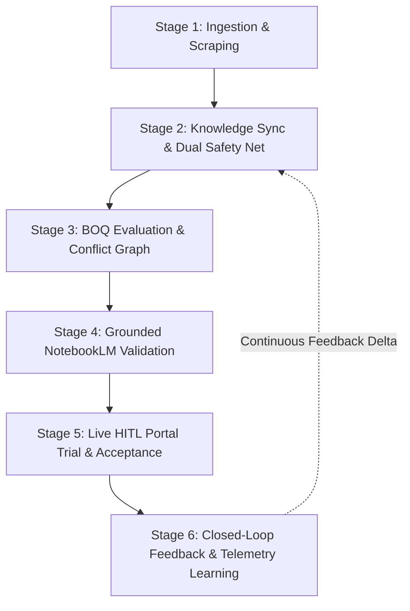

# Macro Continuous Learning Lifecycle Orchestrator (`orchestrator-workflow-skill`)

## 1. Scope & Lifecycle Architecture
This skill manages the macro 6-stage continuous learning lifecycle across live WebLogic scraping, decoupled knowledge synchronization, dual-brain BOQ evaluation, grounded NotebookLM verification, human-in-the-loop portal trials, and telemetry reinforcement learning.

- **Dual-Brain Harmony**: Balances deterministic local verification with agentic cloud reasoning.
- **Atomic Operations**: All state mutations MUST use `safeWriteJsonAtomic` from `scripts/lib/system/fs_compat.js`.
- **Normative Directives**: Comply with [Normative Language Standard](../../rules/normative_language.md).



---

## ⛔ HALT Conditions

```
HALT-ORCH1: If an unhandled exception or crash occurs in any stage without safe failure ledger recording:
  emit [ERR_ORCHESTRATOR_UNHANDLED_CRASH] and record event in outputs/history/failure_ledger.json.
  Do NOT leave file system in partially committed state.

HALT-ORCH2: If stage dependency prerequisites are unsatisfied (e.g., Stage 3 attempted without Stage 1/2 catalog):
  emit [ERR_ORCHESTRATOR_PREREQUISITE_MISSING] and halt forward transition.
  Remediation: Complete prerequisite catalog ingestion before launching evaluations.

HALT-ORCH3: If circular execution loop is detected across stage transitions (>3 iterations on same manifest):
  emit [ERR_ORCHESTRATOR_CYCLE_DETECTED] and escalate to Human Architect (HITL).
```

---

## 2. The 6-Stage Continuous Learning Lifecycle

### Stage 1: Ingestion (Live Scraping & Self-Healing Navigation)
- Dynamic multi-pillar navigation across Server, Storage, SAN, Synergy, and HPC.
- Executes via [`oca-catalog-scraper`](../oca-catalog-scraper/SKILL.md) and [`oca-portal-navigator`](../oca-portal-navigator/SKILL.md).
- Stale-session self-healing via Tab 1 refresh (`INV-89`, `INV-173`).

### Stage 2: Decoupled Knowledge Sync & Dual Safety Net
- Dual-tier output: full `.xlsx`/`.csv` for humans on Drive + structured `.md` payload for Gemini semantic reasoning (`INV-132`).
- Executes via [`knowledge-sync-skill`](../knowledge-sync-skill/SKILL.md).

### Stage 3: BOQ Ingestion & Conflict Graph Resolution
- 7 physical aspect checks + 5-tier strategy matrix ranking.
- Executes via [`boq-eval-skill`](../boq-eval-skill/SKILL.md) and canonical `eval_boq.js`.

### Stage 4: Grounded NotebookLM RAG Validation
- Authoritative QuickSpecs PDF validation with ephemeral solution sheet pattern (`INV-24`).
- Executes via [`nlm-skill`](../nlm-skill/SKILL.md).

### Stage 5: Live HITL Portal Trial & Acceptance Gate
- Live authenticated WebLogic verification (`INV-201`, Gate B19).
- Executes via [`clic-portal-validation-skill`](../clic-portal-validation-skill/SKILL.md).

### Stage 6: Closed-Loop Feedback & Telemetry Learning
- Persists newly evidenced rules into `catalog_deltas.json` and `master_knowledge_registry.json`.
- Reinforces cited rules across $\ge 3$ observations (`INV-224`, `INV-225`).
- Executes via [`continuous-learning-skill`](../continuous-learning-skill/SKILL.md).

---

## 3. Sub-Skill Dispatch Directory
Consult the Master Dynamic Skill Dispatch Matrix in [AGENTS.md](../../../AGENTS.md) for specialized route delegations:
- **Tender Decomposition**: [`multi-cluster-tender-skill`](../multi-cluster-tender-skill/SKILL.md)
- **Least-Delta Alternative**: [`least-delta-combinator-skill`](../least-delta-combinator-skill/SKILL.md)
- **Workload Classification**: [`workload-dna-skill`](../workload-dna-skill/SKILL.md)
- **Commercial Remarks**: [`boq-remarks-reconciliation-skill`](../boq-remarks-reconciliation-skill/SKILL.md)
- **Adversarial Red-Teaming**: [`adversarial-validation-skill`](../adversarial-validation-skill/SKILL.md)
- **Turnkey Delivery Completeness**: [`turnkey-racking-cabling-skill`](../turnkey-racking-cabling-skill/SKILL.md)

---

## 4. References & Lifecycle Appendices
- [Macro MCP Server Execution Protocol](../../../scripts/services/mcp_server.js) via `executeToolRequest()`
- [Full original orchestrator text](references/orchestrator_full_original_reference.md): core agentic principles, MCP token-preservation guidelines, human-triggered lifecycle, multi-agent delegation protocol, INV-1..120 guardrails, stage checkpoint matrix, execution trace and delta protocol
- [Master System Invariants Directory](../../../docs/INVARIANTS.md)
- [Master Operating Charter](../../../AGENTS.md)
