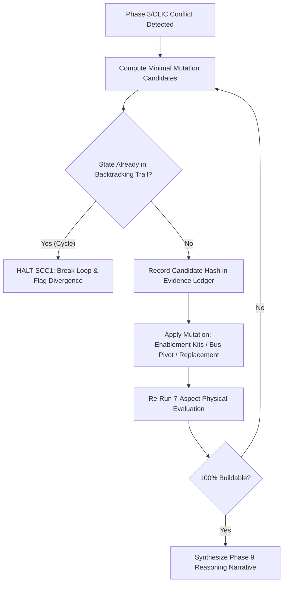

# Self-Correction & Counterfactual Reasoning Engine (`self-correction-counterfactual-skill`)

## 1. Scope & Theoretical Framework
This skill governs the autonomous backtracking search, minimum mutation set derivation, and epistemic self-correction trails when candidate configurations violate physical constraints or CLIC portal validation rules (`INV-202`, `INV-215`).

- **Counterfactual Derivation**: Rather than failing blindly or silently mutating customer quantities, the engine asks: *"What is the minimal set of hardware mutations required to transform this unbuildable tender into a 100% buildable, certified solution while maximizing customer intent preservation?"*
- **Deterministic Hashing**: Every intermediate candidate configuration is hashed via SHA-256 (`evidenceSnapshot`) to guarantee loop-free backtracking.
- **Phase 9 Narrative Binding (`INV-191`, `INV-215`)**: Emits the auditable 5-step numbered reasoning narrative (`generateEvaluationNarrative()`) into the execution ledger.
- **Normative Directives**: Comply with [Normative Language Standard](../../rules/normative_language.md).

---

## ⛔ HALT Conditions

```
HALT-SCC1: If candidate mutation set oscillates between identical configurations (hash collision in trail):
  emit [ERR_SELF_CORRECTION_CYCLE_DETECTED] and HALT backtracking immediately.
  Remediation: Retain current best-effort candidate and flag for HITL architectural review.

HALT-SCC2: If self-correction mutations exceed threshold (>40% of original customer line items altered):
  emit [ERR_EXCESSIVE_MUTATION_DISTANCE] and flag solution as divergent alternative rather than Rank 1.
  Remediation: Spawn parallel Rank 2/Rank 3 paths preserving original intent as Rank 0 (unbuildable).

HALT-SCC3: If Phase 9 reasoning narrative fails to serialize or contains null/undefined block summaries:
  emit [ERR_NARRATIVE_SERIALIZATION_FAILED] and enforce safe text generation before export.
```

---

## 2. The 5-Step Counterfactual Derivation Flow



---

## 3. The 5-Step Numbered Reasoning Narrative (`INV-191`)
Every customer deliverable MUST serialize the standardized 5-step numbered reasoning trace:

1. **Step 1: BOM Detection & Classification**: Identifies customer source lines, quantities, detected chassis model, and component role mappings.
2. **Step 2: 7-Aspect Physical Math Checks**: Displays explicit equations and constraint proofs across TDP, Memory Channels, PCIe Slots, and Power Envelopes.
3. **Step 3: Conflicts & Deterministic Auto-Fixes**: Enumerates detected conflicts and links each auto-injected enablement kit to its root invariant.
4. **Step 4: Ranked Strategies (Rank 1A, 1B, 1L)**: Explains the architectural trade-offs between parallel valid topologies.
5. **Step 5: Required Actions & Portal Validation Status**: Discloses current evidence state (`PORTAL VALIDATION PENDING` or cryptographic receipt hash).

---

## 4. Code Implementation Links & References
- [`EvidenceLedger`](../../../scripts/lib/system/evidence_ledger.js) — Tracks `candidateAttempts`, `phaseResolutions`, and `activeRulesReached`.
- [`generateEvaluationNarrative()`](../../../scripts/lib/boq/eval_output_serializer.js) — Renders the canonical 5-step narrative.
- [`least-delta-combinator-skill`](../least-delta-combinator-skill/SKILL.md) — Prunes cascading dependency trees.
- [Master System Invariants Directory (INV-202, INV-215)](../../../docs/INVARIANTS.md)
