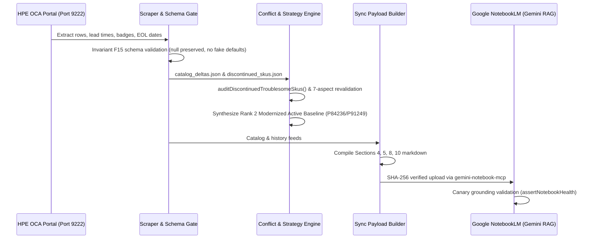

# Audit Report: SKU Lifecycle Intelligence, 90-Day Clearance Strategy & Live OCA Validation — 20 October 2026

## 1. Executive Summary
During live presales evaluation and catalog intelligence queries for **HPE ProLiant DL380a Gen12** (`P76706-B21`), live WebLogic DOM extraction via Chrome DevTools Protocol (CDP port 9222) verified key supply chain, badge, and lifecycle transitions. 

This audit documents:
1. The factual in-configurator state of requested SSD SKUs (`P70436-B21`, `P84236-B21`, `P78810-B21`, `P91249-B21`, and `P50224-B21`).
2. The presales commercial strategy for 90-day EOL components (preventing false binary rejections and capturing high-margin clearance discounts).
3. The end-to-end 3-tier system architecture guaranteeing honest data contracts, robust substitutions, and grounded Google NotebookLM RAG citations.

---

## 2. Live WebLogic DOM Extraction & Factual Findings (DL380a Gen12)

Live extraction from authenticated HPE One Config Advanced (OCA) session `D791354A8B0BA85F27186BD9BDBD86EB` for chassis `P76706-B21`:

| Part Number | Vendor Description | Unit List Price (USD) | Recommendation Badge | Shipment Lead Time | Lifecycle State / EOL Date |
| :--- | :--- | :--- | :--- | :--- | :--- |
| **`P70436-B21`** | HPE 15.36TB NVMe Gen4 High Perf RI SFF BC U.3 PS1010 SSD | *Delisted* | None | *None* | **Delisted / Removed from DOM** (Superseded) |
| **`P84236-B21`** | HPE 15.36TB NVMe Gen4 Mainstream RI SFF BC U.3 CD9 SSD | \$77,706.00 | **`hpe_recommended diamond`** (Diamond Preferred) | **3 Days** (Green Indicator) | Active (End Date: 2028-06-30) |
| **`P78810-B21`** | HPE 15.36TB NVMe Gen4 High Perf RI SFF BC U.3 PM1753 SSD | \$144,914.00 | Standard | **11 Days** (Green Indicator) | Active (End Date: 2028-06-30) |
| **`P91249-B21`** | HPE 15.36TB NVMe Gen4 High Perf RI SFF BC U.3 Multi Vendor SSD | \$131,541.00 | Standard | **Unpublished / Null** (`display: none`, White) | Active (End Date: 2028-06-30) |
| **`P50224-B21`** | HPE 15.36TB NVMe Gen4 High Perf RI SFF BC U.3 PM1733a SSD | \$86,062.00 | Clearance | Distributor / Channel Buffer | **90-Day EOL Warning** (End Date: **2027-01-31**) |

### Key Observations:
- **`P70436-B21` Delisted**: The single-vendor PS1010 model has been completely delisted from the live configurable tree. Any customer BOQ specifying this SKU will fail live CLIC validation unless substituted.
- **`P84236-B21` Promoted to Diamond Preferred**: With a confirmed 3-day lead time and aggressive \$77,706.00 pricing, HPE has designated this as the primary recommended NVMe RI SSD for DL380a Gen12.
- **`P91249-B21` Delivery Risk**: While functionally equivalent to `P70436-B21` (High Performance Multi Vendor), its lead time is unpublished in OCA (`leadTimeDays: null`). Quoting this without inventory verification introduces supply-chain delivery risk.
- **`P50224-B21` Clearance Opportunity**: Shows a **-42.01% price drop** (from \$148,401.00 to \$86,062.00) with a hard discontinuance date of **January 31, 2027** (~100 days remaining).

---

## 3. Presales Strategy: Dual-Track 90-Day Clearance vs. Production Baseline

A rigid rule engine would reject `P50224-B21` as "impending obsolete" or force an unwanted substitute. In enterprise presales, this is counter-productive because:
1. **Massive CapEx Advantage**: \$58,852 savings per drive (\$86,062 vs \$144,914 PM1753).
2. **Immediate Project Rollouts**: For tenders deploying in Q4 2026 or early Q1 2027 where distributor inventory can be committed immediately, `P50224-B21` provides immediate ROI.

### Presales Recommendation Pattern
The solution presents both options side-by-side using standardized commercial remarks (`scripts/lib/boq/commercial_remarks.js`):
- **Option A (Long-Term Production Standard)**: `P84236-B21` (Diamond Preferred, 3-day SLA, \$77,706).
  *Remark*: `[RECOMMENDED PRODUCTION BASELINE] Active lifecycle, guaranteed multi-year expansion, 3-day channel fulfillment.`
- **Option B (Fast-Track / Value-Engineered Clearance)**: `P50224-B21` (90-Day EOL, \$86,062).
  *Remark*: `[FAST-TRACK / CLEARANCE OPTION] Valid for immediate procurement; must be ordered before 31-Jan-2027. High CapEx savings if hardware is stocked now. Not recommended for phased rollouts expanding past Q1 2027.`
- **Option C (High-Performance Direct Multi-Vendor)**: `P91249-B21` (\$131,541).
  *Remark*: `[DELIVERY RISK WARNING] Lead time unpublished in OCA. Verify distributor buffer inventory before quoting committed delivery SLAs.`

---

## 4. Architectural Verification Across the 3 System Tiers

1. **Tier 1 — Scraping & Schema Validation**:
   - `dom_extract.js` extracts recommendation badges from `.td_prod` and inline SVGs while ignoring empty spans.
   - Lead times are parsed into days; missing lead times remain `leadTimeDays: null` / `Unpublished by OCA` per Invariant F15.
2. **Tier 2 — BOQ Evaluation & Strategic Substitution**:
   - `least_delta_combinator.js:auditDiscontinuedTroublesomeSkus` checks customer inputs against `discontinued_skus.json`.
   - `_scoreActiveReplacementCandidate` matches candidates on capacity, interface, workload, form factor, and historical budget anchor.
   - Synthesizes **Rank 2: Modernized Active Baseline (`MODERNIZED_ACTIVE_BASELINE`)** with 100% buildable parts.
3. **Tier 3 — Google NotebookLM Grounding & Sync**:
   - `sync_payload_builder.js` constructs high-density markdown tables in Sections 4, 5, 8, and 10.
   - Synchronized via `gemini-notebook-mcp` with SHA-256 fingerprinting, ensuring Gemini Dual-Brain RAG cites authentic supply chain and lifecycle intelligence.
