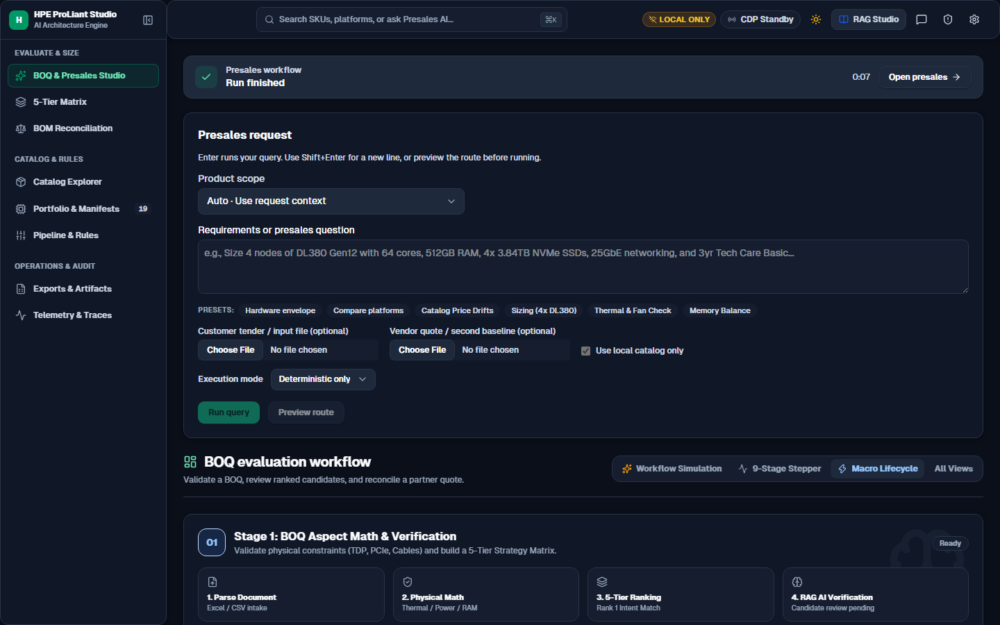

# Dashboard walkthrough

**26–27 November 2026 · Local production build.** The modernization started from `0456ce8f`. I used Chrome via Windows Computer Use for the visual inspection and Chromium via Playwright to repeat the interactions at fixed viewport sizes. QA used synthetic requests and a local-only server.

## Issues found and fixes

| Observed issue | Fix and verification |
| --- | --- |
| Searching the known base chassis `P73282-B21` returned no catalog matches. | Index the nested SKU records and prefer exact part numbers. Clicking the result now selects DL380 Gen12 and applies the exact catalog filter. Chrome showed one result at the captured list price of $5,584. |
| Focus could leave Feedback and Quarantine. Escape did not close the phone navigation drawer. | Apply the shared modal focus behavior and preserve focus on the trigger when closing. The omnibox shortcut yields to open dialogs. |
| The timeline had no server-sourced tier, showed a placeholder progress percentage, and could label agent synthesis as grounded evidence. | Stream actual tiers and structured tool activity. Use recorded progress and display provider synthesis separately from document citations. |
| Telemetry requests could outlive a navigation change. | Abort a request when the view unmounts or a refresh supersedes it. The active view retains its error and retry handling. |
| Two catalog badges were difficult to read in Dark mode and primary actions needed stronger contrast. | Use semantic badge and primary-action colors appropriate to each theme. |
| The comparison preset routed to general Q&A, and the comparison view read a list of platform names as result rows. | Give the preset a concrete workload. Render the canonical matrix rows, including pricing status and structured growth limits. |
| Notebook fan-out omitted the Studio’s local-only flag and limited the visible product picker. | Pass the shared policy through the drawer and show all available products, with a five-selection cap. |
| The initial JavaScript bundle triggered Vite's size warning. | Load Settings and NotebookLM RAG when opened. |

## Screenshots

| View | Light | Dark |
| --- | --- | --- |
| Presales Studio | [Desktop](dashboard-walkthrough/studio-light.png) | [Desktop](dashboard-walkthrough/studio-dark.png) |
| Exact SKU search | [Omnibox](dashboard-walkthrough/search-light.png) | [Omnibox](dashboard-walkthrough/search-dark.png) |
| Filtered catalog | [DL380 Gen12](dashboard-walkthrough/catalog-light.png) | [DL380 Gen12](dashboard-walkthrough/catalog-dark.png) |
| Routed hardware envelope | [Capability card](dashboard-walkthrough/envelope-detail-light.png) | [Capability card](dashboard-walkthrough/envelope-detail-dark.png) |
| Platform comparison | [DL380 vs. DL360](dashboard-walkthrough/compare-detail-light.png) | [DL380 vs. DL360](dashboard-walkthrough/compare-detail-dark.png) |
| Local notebook fan-out | [Provenance](dashboard-walkthrough/rag-light.png) | [Provenance](dashboard-walkthrough/rag-dark.png) |
| Phone, 390×844 | [Studio](dashboard-walkthrough/phone-light.png) | [Studio](dashboard-walkthrough/phone-dark.png) |

The original build stayed at `rgb(248, 250, 252)` under both system preferences. [Original Light preference](dashboard-walkthrough/baseline-light.png) · [Original Dark preference](dashboard-walkthrough/baseline-os-dark.png).

## Verification

The browser matrix covers all eight primary views at 1440×900, 1024×768, 768×1024 and 390×844, native theme controls, theme persistence, sidebar collapse, mobile navigation, drawer focus, exact SKU handoff, route preview and deterministic execution. See [browser results](dashboard-walkthrough/browser-results.json).

| Gate | Result |
| --- | --- |
| `npm --prefix dashboard test -- --run` | Passed · 100 tests in 16 files |
| `npm run test:smoke` | Passed · 8 of 8 suites (`7.89s`) |
| `npm --prefix dashboard run build` | Passed · built in `10.27s` (`index-BfHr-Hfz.js` 616.83 kB, CSS 116.38 kB) |
| `npm run lint:all` | Passed · 0 warnings, 0 errors across 871 files |
| `npm run lint:complexity` | Passed · 0 of 5,375 functions above CC 30; 0 3D ratchet breaches (`CC<=20`, `LOC<=80`, `Nest<=4`, 337 frozen legacy entries) |
| `npm run update:graph` and `npm run verify:graph` | Passed · 13,410 nodes, 30,310 links, 551 communities, 40/40 connected skills |
| `test:circular`, `test:deadcode`, `test:skills` | Passed · 0 cycles (867 files), 4 allowlisted library files (868 files), 40/40 skills (`289` INVs, `2,263` SKUs) |
| Agent, copilot & comparator integration routes | Passed · `test_agent_copilot_and_intelligence_routes.js` (6/6), `test_cross_solution_and_vendor_comparison.js` (4/4 checks), `test_solution_comparator_and_scaling_interpolator.js` (10/10) |
| Offline release & full-portfolio E2E suites | Passed · `test_dashboard_browser_e2e.js` (Orders 1–5) & `test_dashboard_full_portfolio_e2e.js` cleanly. [Release evidence](../../outputs/history/dashboard_release_evidence.json) |
| Live `/browser` QA on `http://localhost:3318` | Passed · responsive (`390×844`, `768×1024`, `1440×900` Light/Dark), Cross-Vendor Dell R760 → DL380 Gen12, `Compare platforms` (`BUILDABLE · PORTAL PENDING`), live `GEMINI_AGENT` + live `AGY_DEEP` + multi-turn continuity + confirmation cards, `Analyze with Antigravity` (`HTTP 200` `RULE_DELTA_PROPOSAL`), `DL325_Gen11` manifest onboarding (`HTTP 200`), `Visual Topology`, `5-Tier Matrix` Conflict/Rule IR + `POST /api/notebook-query-async` (`HTTP 202`, 0 `409`s), `RAG Studio`, 0 console errors |

The offline Playwright suites passed zero external requests, and the follow-up live `/browser` E2E verification (`BROWSER_HOST_FACTS` strictly on `http://localhost:3318`, `blocked_origins: none`, screenshots at `C:/Users/latha/.gemini/antigravity/brain/ab7b09cf-64a7-4551-8fc8-1970716cddee/browser_evidence/d8518ec6-b13d-45aa-88d9-deb28e9dda61/final_step_117.png`, `.../3688b8ad-846c-44bf-9247-71c94c061d89/final_step_80.png`, and `.../3688b8ad-846c-44bf-9247-71c94c061d89/final_step_131.png`) certified live 3-tier execution (`DETERMINISTIC → GEMINI_AGENT → AGY_DEEP`), closed-loop feedback analysis, cross-vendor mapping, manifest onboarding, and background RAG dispatch with zero console errors.

## Online acceptance

Live Gemini (`GEMINI_AGENT`), Antigravity (`AGY_DEEP`), and dashboard feedback analysis (`POST /api/feedback/analyze-with-agent`) are verified on `http://localhost:3318/`. Live HPE OCA (`CLIC`) portal receipt acceptance and live authenticated CDP portal scraping remain **`PORTAL VALIDATION PENDING`** outside an interactive HPE SSO Chrome session.

