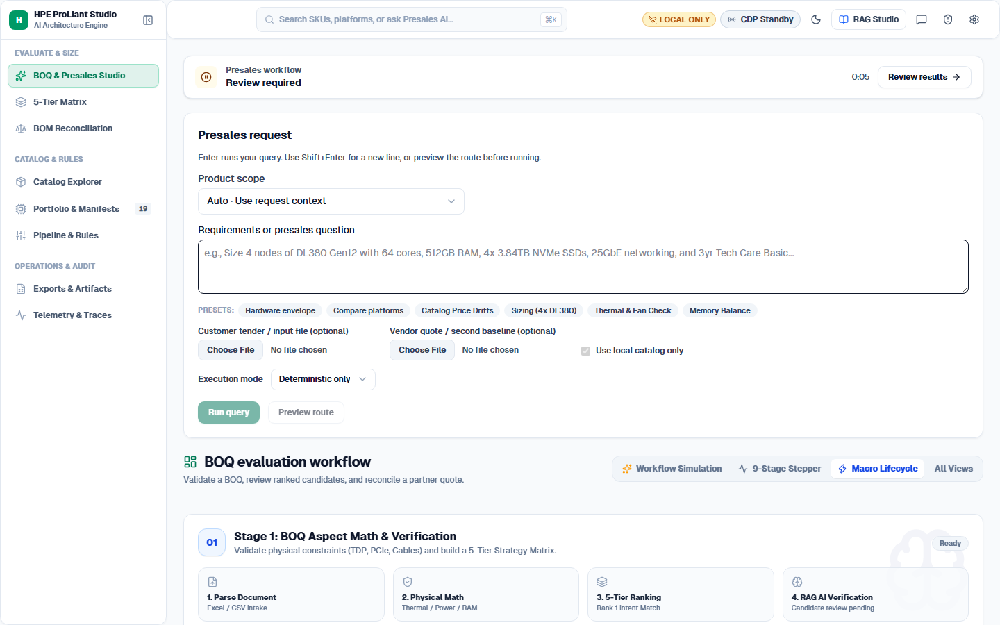

# Dashboard walkthrough

**26 November 2026 · Local production build.** The modernization started from `0456ce8f`. I used Chrome via Windows Computer Use for the visual inspection and Chromium via Playwright to repeat the interactions at fixed viewport sizes. QA used synthetic requests and a local-only server.

## Issues found and fixes

| Observed issue | Fix and verification |
| --- | --- |
| Searching the known base chassis `P73282-B21` returned no catalog matches. | Index the nested SKU records and prefer exact part numbers. Clicking the result now selects DL380 Gen12 and applies the exact catalog filter. Chrome showed one result at the captured list price of $5,584. |
| Focus could leave Feedback and Quarantine. Escape did not close the phone navigation drawer. | Apply the shared modal focus behavior and preserve focus on the trigger when closing. The omnibox shortcut yields to open dialogs. |
| The timeline had no server-sourced tier, showed a placeholder progress percentage, and could label agent synthesis as grounded evidence. | Stream actual tiers and structured tool activity. Use recorded progress and display provider synthesis separately from document citations. |
| Telemetry requests could outlive a navigation change. | Abort a request when the view unmounts or a refresh supersedes it. The active view retains its error and retry handling. |
| Two catalog badges were difficult to read in Dark mode and primary actions needed stronger contrast. | Use semantic badge and primary-action colors appropriate to each theme. |
| The initial JavaScript bundle triggered Vite's size warning. | Load Settings and NotebookLM RAG when opened. |

## Screenshots

| View | Light | Dark |
| --- | --- | --- |
| Presales Studio | [Desktop](dashboard-walkthrough/studio-light.png) | [Desktop](dashboard-walkthrough/studio-dark.png) |
| Exact SKU search | [Omnibox](dashboard-walkthrough/search-light.png) | [Omnibox](dashboard-walkthrough/search-dark.png) |
| Filtered catalog | [DL380 Gen12](dashboard-walkthrough/catalog-light.png) | [DL380 Gen12](dashboard-walkthrough/catalog-dark.png) |
| Routed hardware envelope | [Result and timeline](dashboard-walkthrough/envelope-light.png) | [Result and timeline](dashboard-walkthrough/envelope-dark.png) |
| Phone, 390×844 | [Studio](dashboard-walkthrough/phone-light.png) | [Studio](dashboard-walkthrough/phone-dark.png) |

The original build stayed at `rgb(248, 250, 252)` under both system preferences. [Original Light preference](dashboard-walkthrough/baseline-light.png) · [Original Dark preference](dashboard-walkthrough/baseline-os-dark.png).

## Verification

The browser matrix covers all eight primary views at 1440×900, 1024×768, 768×1024 and 390×844, native theme controls, theme persistence, sidebar collapse, mobile navigation, drawer focus, exact SKU handoff, route preview and deterministic execution. See [browser results](dashboard-walkthrough/browser-results.json).

| Gate | Evidence |
| --- | --- |
| Dashboard tests | Latest full run pending. The previous completed run passed 96 tests in 16 files. |
| Smoke | 8 of 8 suites passed. |
| Production build | Build passed following the bundle split. Latest build pending. |
| Lint, complexity and ratchet | Lint and complexity checks passed. The last audit counted 5,318 functions and zero above CC 30. |
| Graph and skills | Graph integrity and 40 of 40 skill checks passed. Final graph refresh pending. |
| Offline browser release and full portfolio | Both passed on the integrated candidate. The release covered offline OCR, workbook binding, restart recovery, run cancellation, sizing and matrix handoff, reconciliation, and mobile topology. |
| Intelligence and agent route tests | 5 passed, including exact SKU lookup, offline routing, and recorded timeline tier. |

## Online acceptance

This pass exercises local-only routing and simulated provider paths. Live Gemini, Antigravity, NotebookLM, and HPE CLIC acceptance remain open in the [continuation plan](2026-11-26-dashboard-modernization-and-agentic-studio-plan.md).

